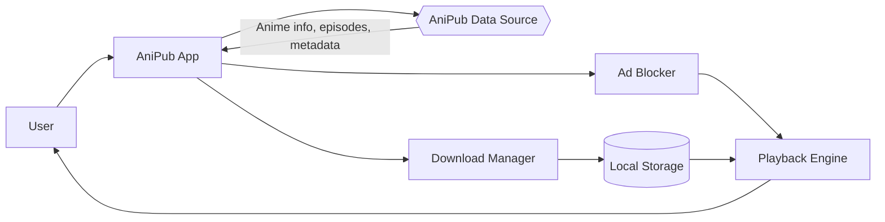
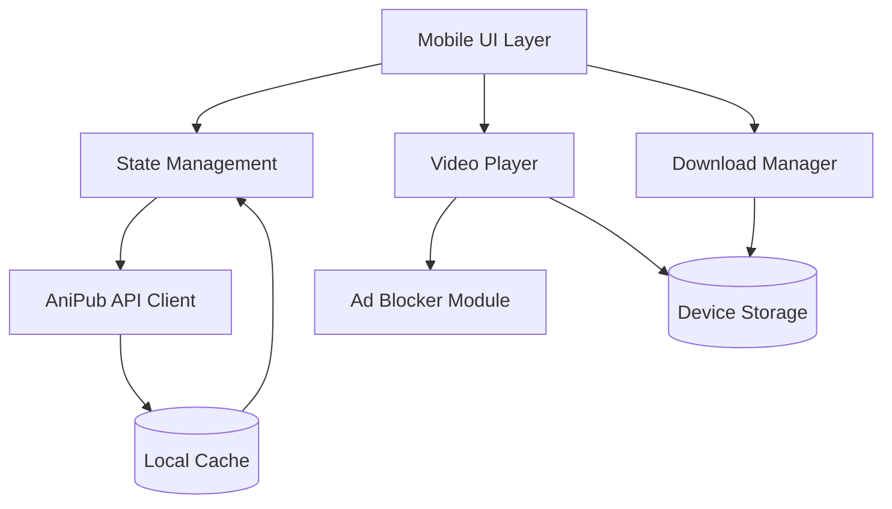
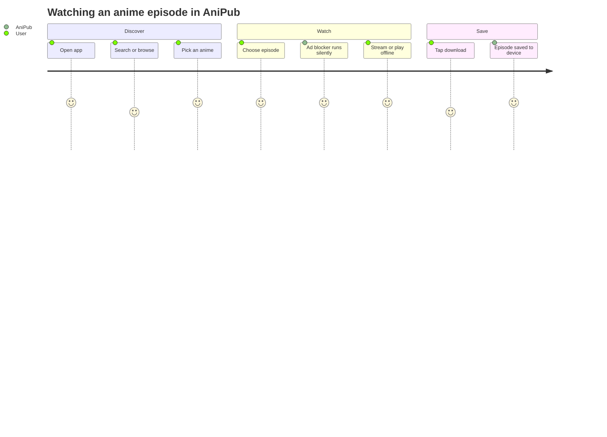
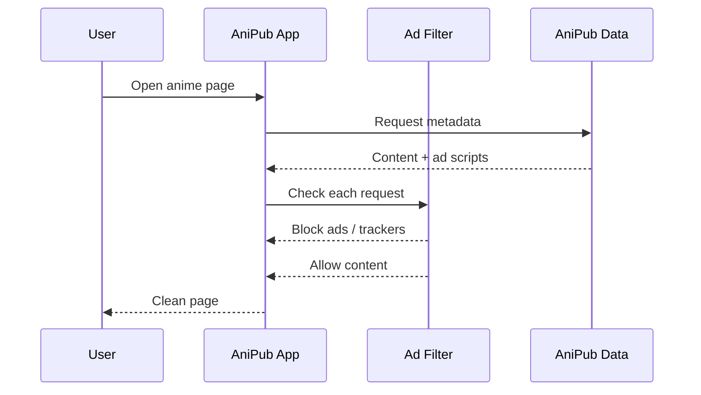
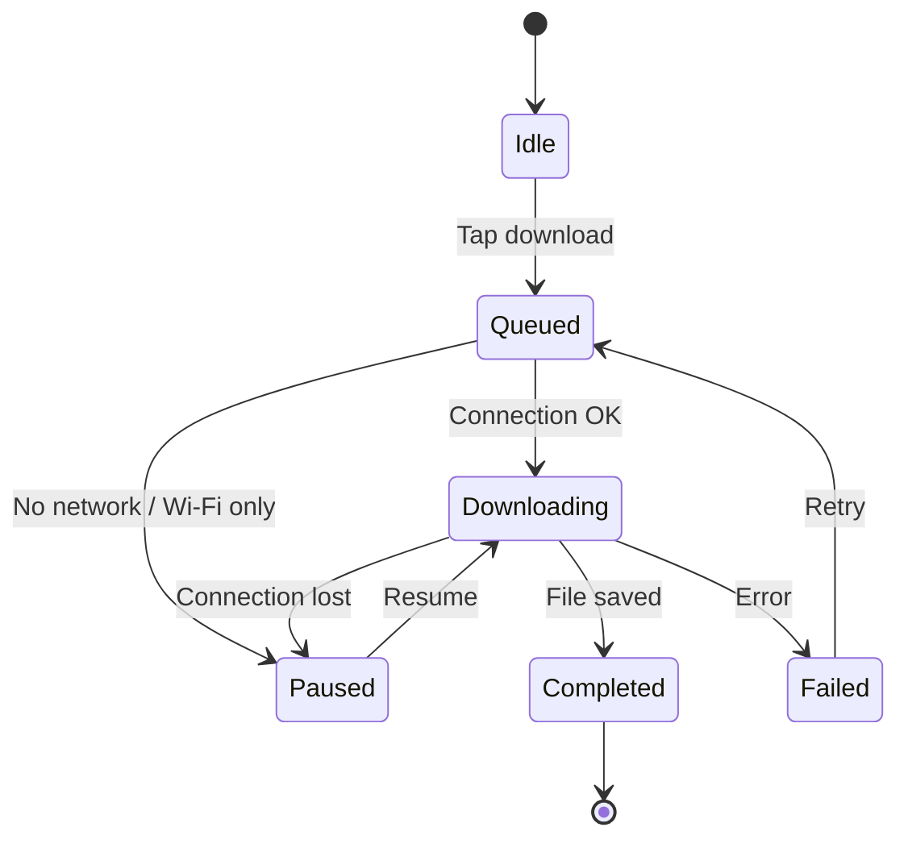

#  AniPub

> A clean, fast, mobile-first anime browser powered by **AniPub** data, with built-in ad blocking and offline downloads.


--------
Download The App
<p align="center">
  <a href="https://github.com/AnimePub/AniPub-APP/raw/master/app/release/app-release.apk" target="_blank">
    
  </a>
</p>


##  Features

| Feature | Description |
|---|---|
|  **Mobile-first UI** | Smooth, touch-friendly browsing designed for phones |
|  **Search & Filters** | Find anime by title, genre, season, or status |
|  **Episode Browser** | Browse seasons, episodes, and details in one place |
|  **Ad Blocking** | Built-in blocker removes popups, banners, and redirects |
| ⬇ **Downloads** | Save episodes for offline viewing |
|  **Watchlist** | Track what you're watching and what's next |
|  **Continue Watching** | Pick up exactly where you left off |
|  **Dark Mode** | Built in Dark Mode ..Easy on the eyes, day or night |

---

## 🧭 How It Works

AniPub doesn't host any content itself. It reads anime metadata from the **AniPub** data source and presents it in a fast, ad-free mobile interface.



---

##  Architecture



---

##  User Flow



---

##  Ad Blocking

AniPub filters ads at multiple layers so pages stay fast and clean.



Blocked by default:
- Pop-up and pop-under windows
- Banner and overlay ads
- Known tracker domains
- Redirect chains

---

##  Download Flow



---

##  Getting Started

### Requirements

- Android 8.0+ or iOS 15+
- Internet connection for first-time browsing
- ~50 MB free space (plus space for downloads)

### Install

```bash
# Clone the repository
git clone https://github.com/AnimePub/AniPub-APP.git
cd anipub

# Install dependencies
build the gradle with Android Studio

# Run on a device or emulator
Press the run button to run this app on your device via usb debugging or wifi debugging 
```


##  Features to Add

- Making The Logo more awesome 
- Making Playlist Sync 

##  Contributing

Contributions are welcome!

1. Fork the repo
2. Create a branch: `git checkout -b feature/amazing-feature`
3. Commit your changes: `git commit -m "Add amazing feature"`
4. Push: `git push origin feature/amazing-feature`
5. Open a Pull Request

---

##  Disclaimer

AniPub is a client app for browsing metadata. It does not host any video content. Users are responsible for complying with copyright laws in their region. Only download content you have the right to access.
-- Will you heed this warning though ? We are pirate by heart .. haha 
---

##  License

Distributed under the GPL3 License. See `LICENSE` for details.

---

<p align="center">Made with ❤️ by AniPub for anime fans on the go</p>